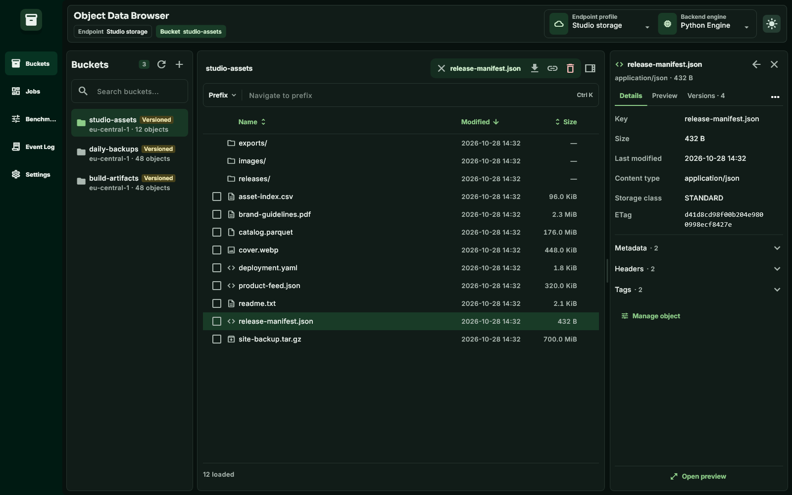
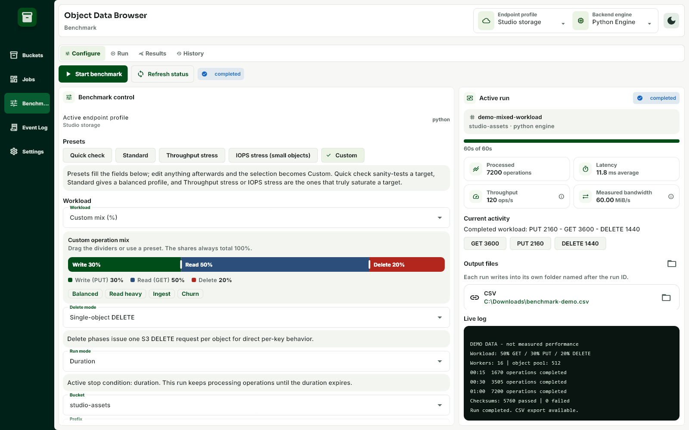
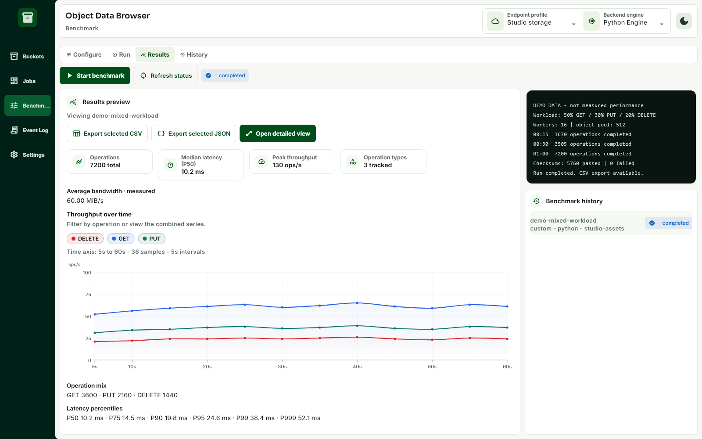
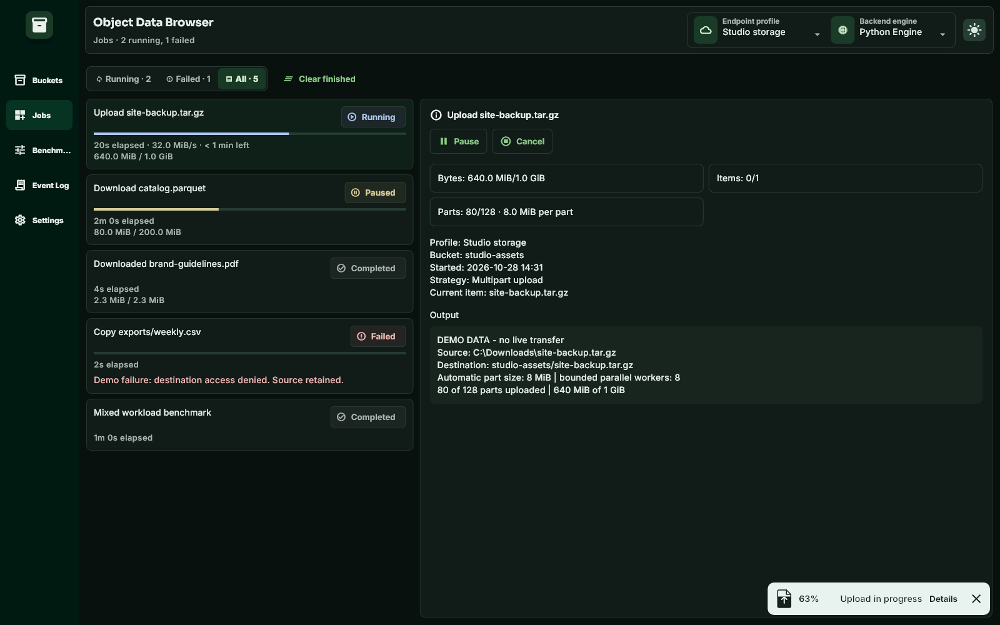
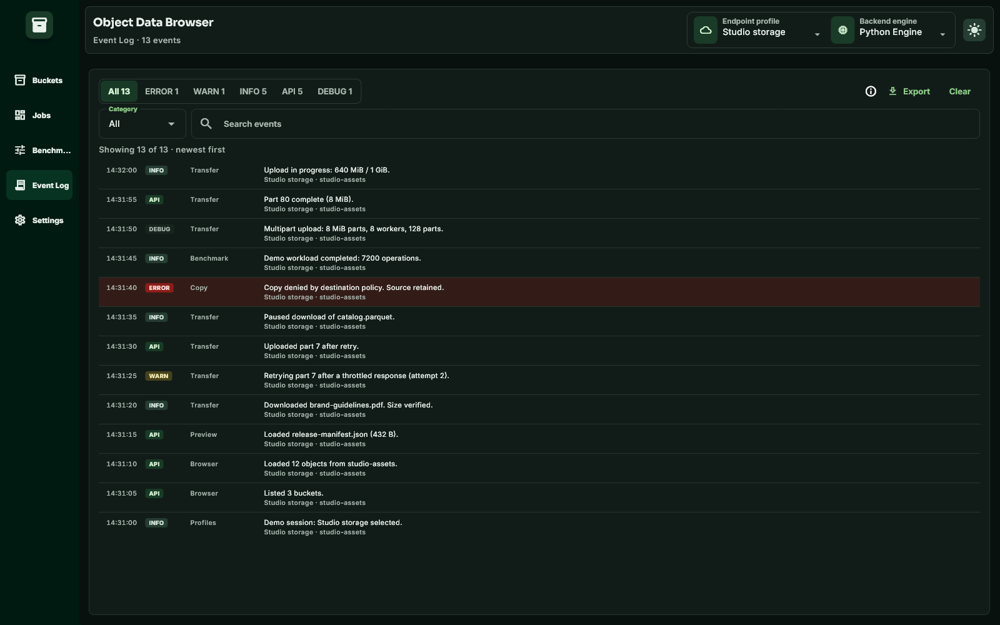
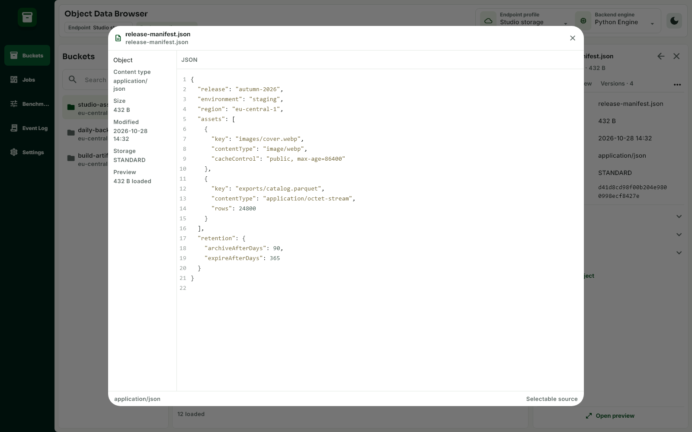
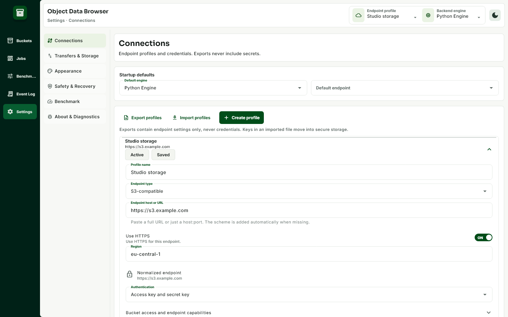

# Object Data Browser

A Flutter app for browsing S3-compatible storage, AWS S3, and Azure Blob Storage. Runs on Windows, macOS, Linux, Android, and iOS, with Python, Go, Rust, and Java engines on desktop.



## What it does

- Browse buckets, folders, objects, and version history. Search, filter, and sort listings.
- Upload and download files with multipart transfers; copy, move, rename, and delete objects.
- Inspect metadata, headers, and tags. Preview highlighted source, images, and static HTML.
- Manage bucket policies, lifecycle rules, versioning, Object Lock, retention, and legal holds where supported.
- Run storage benchmarks, export results to CSV, and inspect jobs and request logs.
- Save endpoint profiles, choose startup defaults, and switch between light and dark themes.

Support varies by provider and engine. On desktop, Azure data operations require Python or Go; advanced administration uses the bundled Python adapter. Live pause, resume, and cancel require Python or Java. See the [feature matrix](docs/FEATURE_MATRIX.md) for details.

## Screenshots

| Benchmark setup | Benchmark results |
| --- | --- |
| [](docs/screenshots/benchmark-configure-light.png) | [](docs/screenshots/benchmark-results-light.png) |

| Jobs and transfer status | Event Log |
| --- | --- |
| [](docs/screenshots/jobs-status-dark.png) | [](docs/screenshots/event-log-dark.png) |

<details>
<summary>More screenshots: source preview and connection settings</summary>





</details>

Screenshots show the Windows layout with fictional data. Benchmark figures illustrate the UI; they are not performance measurements. [Regenerate them](docs/screenshots/README.md).

## Download

Get installers and checksums from [GitHub Releases](https://github.com/sndstone/object-data-browser/releases).

The [2.3.3 desktop prerelease](https://github.com/sndstone/object-data-browser/releases/tag/v2.3.3) includes:

| Platform | Package |
| --- | --- |
| Windows x64 | MSI, unsigned development build |
| Linux x64 / ARM64 | DEB and RPM; glibc 2.31 or newer |
| macOS Apple Silicon, 12+ | Development DMG, ad-hoc signed and not notarized |

Use the DEB on Linux Mint 20 or newer. After updating the macOS development build, you may need to re-enter credentials. Version 2.3.3 has no Windows ARM64, Android, or iOS package; older Android test builds are listed in earlier releases.

## Connect

1. Open **Settings > Connections** and create a profile.
2. Choose S3-compatible, AWS S3, or Azure Blob. Enter the endpoint, region where applicable, and credentials. For Azure account-key authentication, use the account name and access key.
3. **Test**, **Save**, then **Use profile** to browse its buckets or containers. Set the default endpoint separately if you want it selected at startup.

Credentials use the platform's secure store. Profile exports contain endpoint settings only. If secure storage fails, the app marks the profile **Session only** and offers a retry.

## Build from source

Clone the repository and run the build script for your platform:

```sh
git clone https://github.com/sndstone/object-data-browser.git
cd object-data-browser
```

Windows PowerShell:

```powershell
.\scripts\build.ps1 -Platform windows
# Or build an Android test APK:
.\scripts\build.ps1 -Platform android
```

Linux / macOS:

```sh
./scripts/build.sh linux
# On macOS with Xcode:
./scripts/build.sh macos
```

Scripts cache Flutter and engine toolchains under `.tmp/toolchains` and put packages in `dist/`. Flutter is pinned in [`.flutter-version`](.flutter-version). Native platform build tools are still required: Visual Studio with Desktop development with C++ on Windows, Xcode on macOS, or the Flutter Linux desktop dependencies on Linux. Windows builds may request elevation to enable symlinks.

For Android builds on Linux, install the Android SDK and set `ANDROID_HOME` or `ANDROID_SDK_ROOT` first. Windows scripts provision it automatically. See [Android packaging](packaging/android/README.md), [macOS signing](packaging/macos/README.md), and [iOS builds and signing](packaging/ios/README.md) for platform details.

## Development

After bootstrapping, add `.tmp/toolchains/flutter/bin` to your `PATH`. From `apps/flutter_app`:

```sh
flutter pub get
flutter analyze
flutter test
```

The [engine contract tests](tests/contract/README.md) run against each backend. Local MinIO/Azurite checks and their limits are documented in [2.3.0 verification](docs/2.3.0-verification.md); they do not establish live-cloud or physical-device qualification.

| Directory | Contents |
| --- | --- |
| `apps/flutter_app` | Flutter UI and platform adapters |
| `engines` | Python, Go, Rust, and Java backends |
| `contracts` | Shared engine API and transport schema |
| `tests` | Engine contract tests and fixtures |
| `scripts`, `packaging` | Toolchain setup, builds, and installers |

See the [changelog](CHANGELOG.md) for release history and [report an issue](https://github.com/sndstone/object-data-browser/issues) for bugs.
